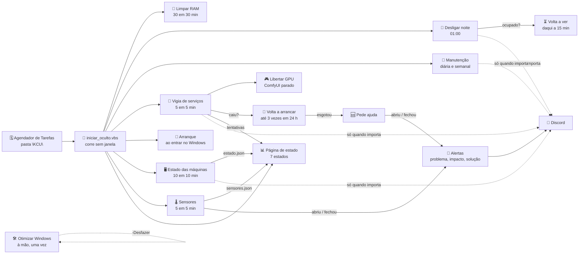

# KCU Automáticos ⚙️

[](https://github.com/KCUServices/kcu-automaticos/actions/workflows/verificar.yml)

**Os scripts que mantêm os nossos PCs Windows a funcionar sozinhos.** Limpam a RAM quando faz falta, desligam o PC de madrugada sem cortar o trabalho a ninguém, fazem manutenção, voltam a arrancar serviços que caem, vigiam temperaturas e discos e avisam no Discord quando algo corre mal, a dizer o que se passa e o que fazer.

> São os mesmos scripts que usamos todos os dias, só que limpos de tudo o que é nosso. Pega, lê, adapta ao teu.
>
> *Windows automation scripts we run every day: smart RAM cleaner, safe nightly shutdown, maintenance, self-healing service watchdog with limited retries, CPU/GPU temperature and disk health sensors, full-context alerts, GPU release for ComfyUI, Wake-on-LAN, machine status and pending updates, a local "operations centre" status page with 7 health states, and reversible Windows tweaks. (In Portuguese.)*

## Como funciona



## O que está aqui

| Pasta | O que faz | Quando |
|---|---|---|
| [`limpar-ram`](limpar-ram) | Esvazia a "lista em espera" da RAM **só** quando há menos de 1 GB livre. Não mexe na memória dos programas. | de 30 em 30 min |
| [`desligar-noite`](desligar-noite) | Desliga o PC de madrugada, **exceto** se alguém o estiver a usar, se a GPU ou a CPU estiverem ocupadas, se o Claude Code estiver a trabalhar ou se um programa da tua lista estiver aberto. Volta a tentar de 15 em 15 min. | 01:00 |
| [`reinicio-reserva`](reinicio-reserva) | Reinicia o PC se ficou ligado e está parado há 30 min. | 05:00 |
| [`manutencao`](manutencao) | Limpa temporários, relatórios de erro, a cache de atualizações e o Docker. Vigia a saúde dos discos e o espaço livre. | diária às 13:30, semanal ao domingo às 14:00 |
| [`vigia-servicos`](vigia-servicos) | Vê se os teus serviços respondem. Se um falha duas vezes seguidas, volta a arrancá-lo, **no máximo 3 vezes em 24 h** e cada vez mais espaçado (logo, 30 min, 60 min); depois para e pede ajuda no Discord. Avisa se o PC se desligou de repente (falta de luz). | de 5 em 5 min |
| [`sensores`](sensores) | Lê as temperaturas do CPU e da GPU (LibreHardwareMonitor) e a saúde dos discos (smartctl). Limites num ficheiro teu. Avisa quando um alerta abre e quando fecha, nunca a repetir. Sinal de vida para o Healthchecks, se quiseres. | de 5 em 5 min |
| [`alertas`](alertas) | O formato dos avisos, em Python e PowerShell, com um catálogo: cada aviso diz equipamento, serviço, hora, problema, evidência, impacto, histórico, causa provável, solução e estado, com nível `CRITICAL`, `HIGH`, `MEDIUM` ou `LOW`. | usado pelos outros |
| [`libertar-gpu`](libertar-gpu) | Quando o ComfyUI está parado com modelos na placa, descarrega-os para os jogos terem a GPU toda. | com o vigia |
| [`arranque`](arranque) | Ao entrares no Windows, abre os programas e serviços da tua lista, **só** se ainda não estiverem abertos. Vê pela porta ou pelo processo. | ao entrar |
| [`acordar-wol`](acordar-wol) | Liga outro PC da casa por Wake-on-LAN e espera que ele responda. | à mão |
| [`estado-maquinas`](estado-maquinas) | Vê se as máquinas da tua lista estão ligadas (ping ou porta) e se têm atualizações pendentes: este PC (Windows Update), Linux com apt, Mac, ou um comando teu por SSH. Escreve `estado.json` e `estado.html` e avisa quando uma cai. | de 10 em 10 min (atualizações de 6 em 6 h) |
| [`estado-pagina`](estado-pagina) | Um "centro de operações" pequeno, **só neste PC** (127.0.0.1): cada serviço e cada máquina com um de 7 estados (Saudável, Aviso, Degradado, A recuperar, Desatualizado, Falhou, Desligado), a partir das tuas verificações, do `estado-maquinas`, do `vigia-servicos` e dos `sensores`. Python, sem instalar nada além do Python. | ao entrar |
| [`medir-fps`](medir-fps) | Mede os FPS de um jogo com o PresentMon oficial da Intel: FPS médio, 1 % baixo, frametimes e quem limita (CPU ou GPU). Grava um resumo em JSON para comparar antes e depois. | à mão |
| [`otimizar-windows`](otimizar-windows) | Tira telemetria, publicidade e sugestões, põe a limpeza automática semanal e (se pedires) afinações para jogos. Só definições documentadas, todas com `-Desfazer`. Lista completa no [README da pasta](otimizar-windows/README.md). | à mão, uma vez |
| [`comum`](comum) | Peças partilhadas: correr escondido, criar tarefas, avisar no Discord. | — |

## Instalar

1. Descarrega o repositório para uma pasta fixa, por exemplo `C:\kcu-automaticos`.
2. Abre o **PowerShell como administrador** e corre o `instalar.ps1` de cada pasta que queres:

   ```powershell
   cd C:\kcu-automaticos
   powershell -ExecutionPolicy Bypass -File limpar-ram\instalar.ps1
   powershell -ExecutionPolicy Bypass -File desligar-noite\instalar.ps1 -Hora 01:00
   powershell -ExecutionPolicy Bypass -File manutencao\instalar.ps1
   ```

3. **Testa primeiro em modo ensaio.** Mostra o que faria, sem apagar nem desligar nada:

   ```powershell
   powershell -File limpar-ram\limpar_ram.ps1 -Ensaio
   powershell -File desligar-noite\desligar_noite.ps1 -Ensaio
   powershell -File manutencao\manutencao.ps1 -Semanal -Ensaio
   powershell -File estado-maquinas\estado_maquinas.ps1 -Ensaio -Completo
   powershell -File sensores\sensores.ps1 -Ensaio
   powershell -File otimizar-windows\otimizar_windows.ps1 -Ensaio
   ```

4. Para desinstalar, corre o mesmo `instalar.ps1` com `-Remover`.

### Avisos no Discord (opcional)

Cria um webhook no teu canal (Definições do canal → Integrações → Webhooks) e guarda-o **numa variável de ambiente**, nunca no código:

```powershell
[Environment]::SetEnvironmentVariable('KCU_DISCORD_WEBHOOK', 'https://discord.com/api/webhooks/...', 'User')
```

### Ligar o PC sozinho de manhã

O desligar noturno só faz sentido se o PC voltar a ligar sozinho. Na BIOS, procura **"RTC Alarm"**, **"Power On By RTC"** ou **"Resume by Alarm"** e põe a hora (por exemplo, 09:00). O nome muda de marca para marca.

### Vigia de serviços

Copia `servicos.exemplo.json` para `servicos.json` e põe lá os teus serviços. Cada um precisa de:
- uma forma de ver se está vivo: `url` (responde?) ou `processo` (está aberto?);
- uma forma de o voltar a arrancar: `tarefa` (uma tarefa agendada) ou `programa` (um .exe);
- opcionalmente, `matar`: um texto do comando dos processos a fechar antes de arrancar de novo.

Um serviço que não volta não fica a ser reiniciado para sempre: o vigia tenta **no máximo 3 vezes em 24 h** (a 1.ª logo, a 2.ª 30 min depois, a 3.ª 60 min depois dessa). Depois disso deixa-o em paz e pede ajuda **uma vez** no Discord, no formato dos [`alertas`](alertas); quando o serviço voltar, avisa também. As tentativas ficam em `vigia_servicos.estado.json`, que a página de estado lê.

### Estado das máquinas

Copia `maquinas.exemplo.json` para `maquinas.json`. Cada máquina tem um `nome` e:
- `host` (responde ao ping?) e/ou `porta` (a porta TCP aceita ligação? conta mais do que o ping, porque há redes que o bloqueiam). Sem nenhum dos dois, é este PC;
- opcionalmente `atualizacoes`: `windows` (este PC), `apt` (Debian, Ubuntu, Proxmox), `macos`, ou `comando` com um `comando` teu que escreve uma linha por atualização pendente. Os três últimos precisam de `ssh` (`utilizador@host`) **com chave, sem password**: testa antes com `ssh utilizador@host echo ok`. Não uses aspas duplas no `comando` (o PowerShell 5.1 estraga-as).

Nada é instalado: só se procura o que está pendente. O resultado fica em `estado.json` e `estado.html`, ao lado do script.

### Página de estado

Precisa do Python 3.8 ou mais recente. Copia `verificacoes.exemplo.json` para `verificacoes.json` e põe lá os teus serviços (`url` ou `porta`, e `host` se não for este PC). Se `maquinas`, `vigia` e `sensores` apontarem para os ficheiros do `estado-maquinas`, do `vigia-servicos` e dos `sensores`, a página junta tudo e dá a cada serviço e a cada máquina um de **7 estados** (as regras estão no [README da pasta](estado-pagina/README.md)). Abre `http://127.0.0.1:8765`. A página escuta só neste PC; não fica visível na rede.

```powershell
powershell -File estado-pagina\arrancar_pagina.ps1 -Ensaio   # faz as verificações uma vez e mostra-as
```

### Sensores

Precisa do LibreHardwareMonitor (os `.dll` em `sensores\lhm\`) e do smartmontools. Os passos estão no [README da pasta](sensores/README.md).

## Cuidados

- **Lê antes de correr.** São scripts com permissões de administrador. Estão comentados linha a linha para os poderes entender.
- **O limpar RAM não acelera um PC com pouca RAM.** Só evita os engasgos quando a cache do Windows ocupa a memória toda. Se o teu PC está sempre no limite, a solução é mais RAM.
- **Os scripts só usam ASCII** (sem acentos), porque o PowerShell 5.1 lê mal os ficheiros sem BOM.

## Episódios

| Ep. | Vídeo | Código | O que mudou |
|---|---|---|---|
| 00 | *em breve* | [ep00](../../tree/ep00) | Primeira versão pública |

O que mudou em cada versão está no [CHANGELOG](CHANGELOG.md).

## FAQ

**Funciona no Windows 10?**
Sim, no 10 e no 11. A versão do PowerShell que já vem com o Windows chega.

**O desligar noturno desligou-me o PC a meio de um jogo!**
Não devia: ele não desliga se usaste o rato ou o teclado nos últimos 20 min, nem com a GPU acima de 30 %. Se aconteceu, abre uma *issue* com o `desligar_noite.log`.

**Posso pôr isto num servidor sem ninguém a usar?**
Sim. Nesse caso tira o `desligar-noite` e fica com o vigia, a manutenção e o limpar RAM.

**Tenho uma ideia.**
Vai às [Discussions](https://github.com/orgs/KCUServices/discussions/categories/ideas).

## Mais da KCU Services

O setup completo onde isto corre está no [kcu-stack](https://github.com/KCUServices/kcu-stack). Outros projetos em [github.com/KCUServices](https://github.com/KCUServices).

## Licença

[PolyForm Noncommercial 1.0.0](LICENSE): podes usar, estudar, alterar e partilhar **para uso pessoal e sem fins comerciais**. Vender, revender ou usar isto num negócio precisa de autorização: fala connosco no Instagram [@kcu.services](https://www.instagram.com/kcu.services).

**Marca e imagens:** o nome KCU, os logótipos e as imagens dos produtos são da KCU Services, com todos os direitos reservados. A licença cobre só o código e a documentação. Ver [MARCA.md](MARCA.md).
